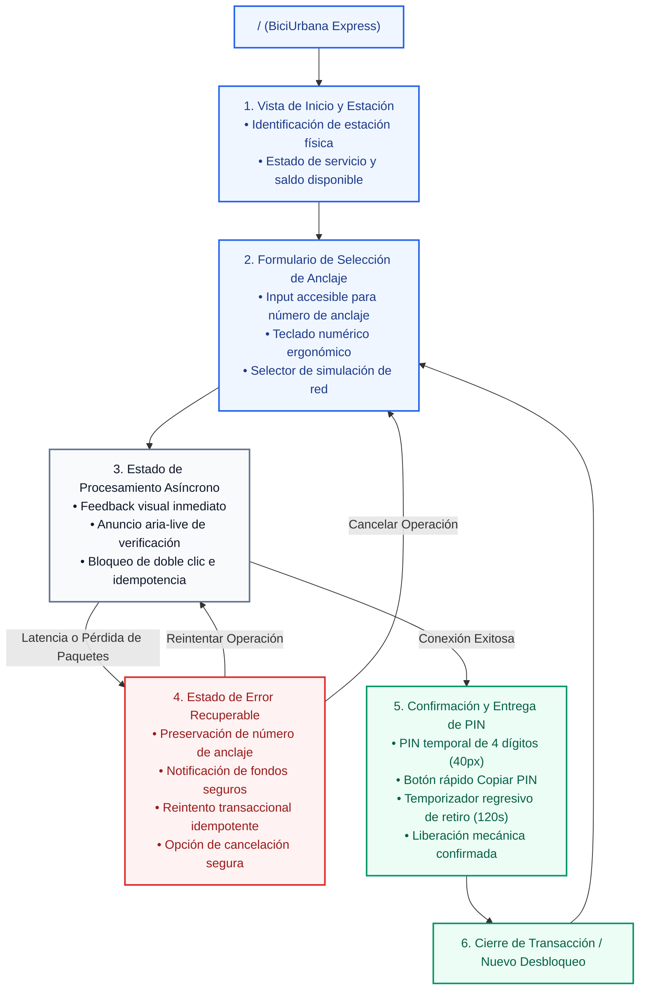

# Arquitectura de Información: Sitemap Jerárquico
## Sistema BiciUrbana: Desbloqueo Express de Bicicleta

---

### 1. Estructura Jerárquica del Sistema

El sistema BiciUrbana está concebido bajo una arquitectura web móvil de página única (*Single Page Application - SPA*) de alta velocidad, estructurada para minimizar niveles de profundidad y evitar recargas completas de página que puedan perder el estado de la sesión durante microcortes.

A continuación se presenta el árbol de navegación del sistema:

---

### 2. Desglose de Vistas y Estados de Interfaz

#### 1. Vista de Inicio y Estación (`#viewHome`)
* **Propósito:** Confirmar la ubicación física del usuario (ej. *"Estación #04 - Plaza Central"*) y validar que el servicio se encuentra operativo.
* **Componentes principales:** Barra superior de estado, indicador de saldo/garantía ($0.00 retenido actualmente).

#### 2. Formulario de Desbloqueo Express (`#viewForm`)
* **Propósito:** Permitir el ingreso ultra rápido del número de anclaje mediante teclado físico o teclado numérico virtual adaptado a la zona inferior del pulgar.
* **Componentes principales:** Input de anclaje con etiqueta visible, botones de atajos numéricos (1 a 18), botón principal "Desbloquear Bicicleta", barra de pruebas de simulación de conectividad.

#### 3. Modal / Capa de Procesamiento Asíncrono (`#viewLoading`)
* **Propósito:** Proveer visibilidad inmediata del estado del sistema (H1 de Nielsen) mientras se establece el enlace con el servidor de la estación.
* **Componentes principales:** Spinner animado de 60 FPS, mensaje textual en región viva (`aria-live="polite"`), bloqueo visual del botón para evitar solicitudes simultáneas.

#### 4. Pantalla de Error Recuperable por Microcorte (`#viewError`)
* **Propósito:** Mitigar la caída de conexión garantizando que no se pierdan datos y que no haya cobros indebidos (H5 y H9 de Nielsen).
* **Componentes principales:** Alerta informativa no punitiva, badge con el número de anclaje previamente digitado, botón destacado "Reintentar conexión", botón secundario "Cancelar operación".

#### 5. Pantalla de Éxito y Retiro Físico (`#viewSuccess`)
* **Propósito:** Entregar el valor central de la tarea (obtención del PIN temporal) y guiar el retiro de la bicicleta dentro del límite de tiempo de seguridad.
* **Componentes principales:** Tarjeta destacada con PIN de 4 dígitos, botón con acción al portapapeles, temporizador regresivo de 120 segundos, botón de confirmación de retiro completado.
