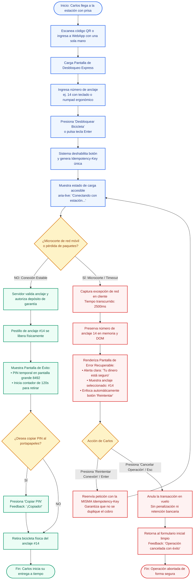

# Diagrama de Flujo de Usuario (User Flow)
## Sistema BiciUrbana: Desbloqueo Express de Bicicleta

---

### 1. Visión General del Flujo

El siguiente diagrama detalla la experiencia del repartidor Carlos al interactuar con el sistema BiciUrbana, contemplando tanto el **camino feliz (*Happy Path*)** como la **bifurcación por microcorte de conectividad**, mostrando cómo se preservan los datos y se previene cualquier cobro duplicado mediante idempotencia:

---

### 2. Análisis de Estados y Transiciones

| Estado Inicial | Evento Desencadenante | Condición / Guarda | Estado Siguiente | Mecanismo de Salvaguarda IHC |
|---|---|---|---|---|
| **Formulario Inicial** | `submit` / `Enter` | Input de anclaje válido (número 1 a 99) | **Procesando (Loading)** | El botón se inhabilita de inmediato para imposibilitar el doble envío compulsivo. |
| **Procesando** | Respuesta HTTP 200 | Conexión sin interrupciones | **Éxito (PIN Entregado)** | Despliegue de PIN temporal en caracteres de 40px y arranque del temporizador de 120s. |
| **Procesando** | Microcorte / Timeout (2500ms) | Pérdida de conectividad detectada | **Error Recuperable** | NO se borra el número de anclaje. El foco del teclado pasa a `#btnRetry`. Saldo protegido. |
| **Error Recuperable** | Clic `#btnRetry` / `Enter` | Usuario desea reintentar | **Procesando (Loading)** | Reenvía la transacción reutilizando la misma `Idempotency-Key` para evitar doble cargo. |
| **Error Recuperable** | Clic `#btnCancel` / `Esc` | Usuario decide no continuar | **Formulario Inicial** | Anula el token y asegura que no exista ningún saldo debitado o retenido. |
